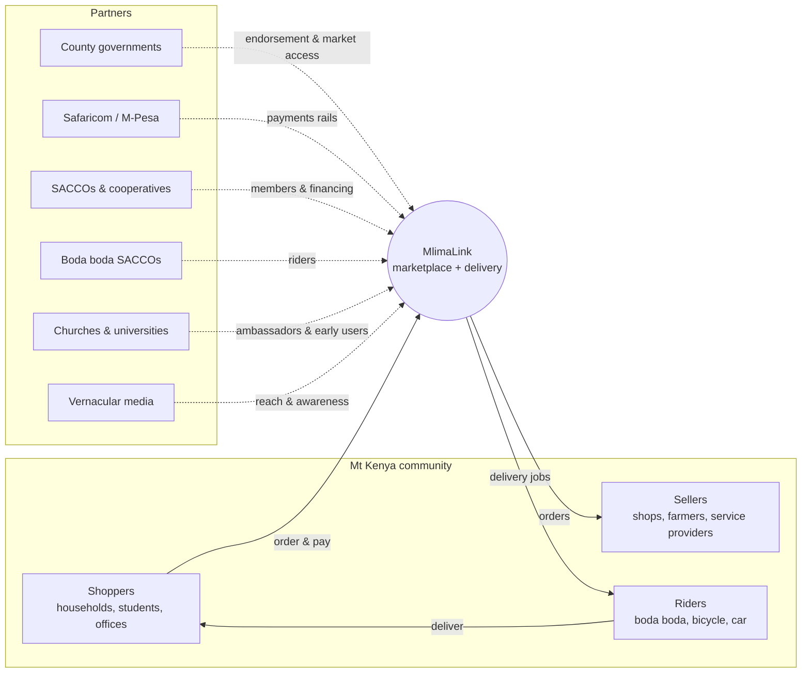
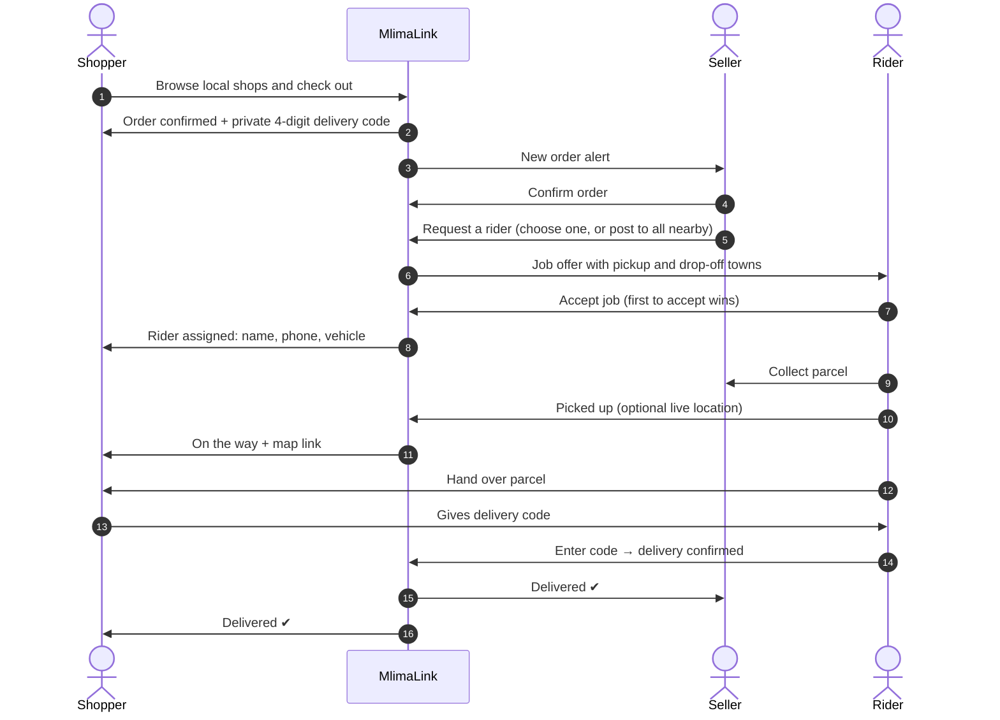
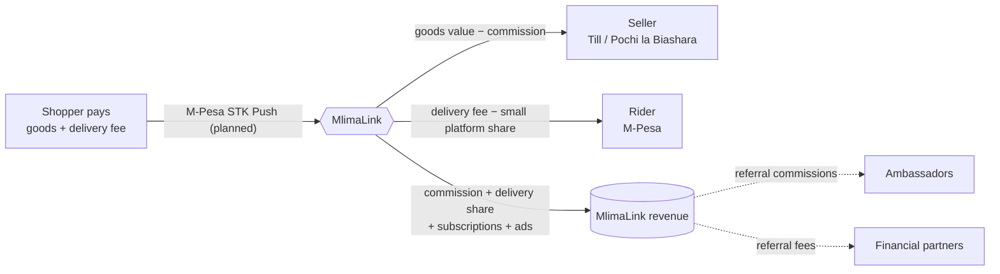
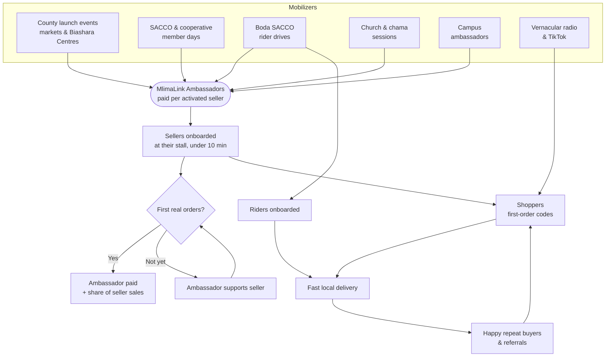
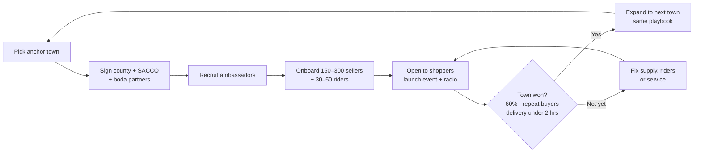
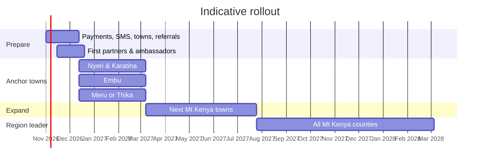
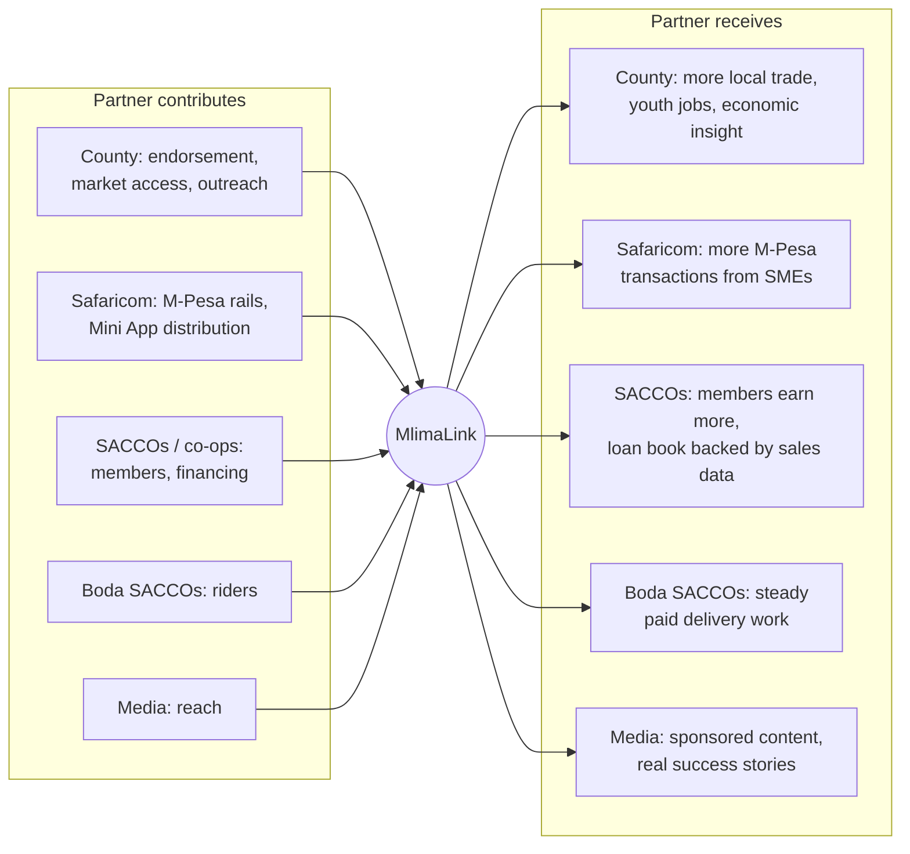

# MlimaLink — How It Works & How Partners Fit In

> **MlimaLink** is a multi-vendor marketplace for the Mt Kenya region. It connects local shops, farmers and service providers with nearby shoppers, and local riders deliver the orders.
>
> This document shows how the platform works and where partners create and share value.

The diagrams use [Mermaid](https://mermaid.js.org/) and render on GitHub, GitLab, Notion and most Markdown viewers.

---

## 1. The ecosystem at a glance

---

## 2. From order to doorstep

**Built-in trust**

- **Pay on delivery** option for shoppers.
- **Delivery code:** only the shopper has it, so the rider can't mark an order delivered without the shopper present. Repeated wrong codes lock the job.
- **Privacy:** riders see the shopper's full contact details only after accepting a job.
- **Tracking:** status timeline and the rider's last shared location.

---

## 3. How money flows

| Revenue stream              | Model                                         |
| --------------------------- | --------------------------------------------- |
| Order commission            | 3–8% by category                              |
| Delivery fee share          | 10–15% of the fee; the rest goes to the rider |
| Seller Pro subscription     | About KSh 500–1,500/month                     |
| Promoted listings & adverts | Category placements                           |
| Service leads               | Small fee per accepted request                |
| Partnerships                | Loans, bike financing, insurance referrals    |

---

## 4. Growth engine: how people join

---

## 5. Town-by-town rollout

Each town must pass clear gates before we expand, so quality grows with coverage.

**Target counties:** Nyeri · Kirinyaga · Murang'a · Kiambu · Nyandarua · Laikipia · Meru · Tharaka-Nithi · Embu

---

## 6. What each partner gives and gets

| Partner                     | What we ask                                                       | What they gain                                      |
| --------------------------- | ----------------------------------------------------------------- | --------------------------------------------------- |
| **County government**       | Endorsement, market-day access, outreach to permit holders        | Local trade growth, youth employment, economic data |
| **Safaricom**               | Daraja integration support, M-Pesa Mini App listing, co-marketing | More SME and consumer M-Pesa transactions           |
| **SACCOs & cooperatives**   | Member onboarding days, co-branded offers                         | Higher member income; sales-backed lending          |
| **Boda boda SACCOs**        | Rider recruitment                                                 | Reliable, paid delivery jobs for members            |
| **Churches & universities** | Hosting sessions, campus ambassadors                              | Economic empowerment for members and students       |
| **Media**                   | Airtime, creator partnerships                                     | Sponsored content, community success stories        |

---

## 7. Why MlimaLink

- **Local first:** built for Mt Kenya towns, local sellers and local riders.
- **Asset-light:** no warehouses and no inventory. We connect existing businesses and independent riders, so we scale cheaply.
- **Trust built in:** pay on delivery, private delivery codes, rider tracking, reviews.
- **More than products:** service providers (fundis, salons, tutors, mechanics) list alongside shops.
- **Jobs:** every town we open creates paid work for riders and ambassadors.

---

## 8. Let's talk

We're looking for partners to launch in our first anchor towns.

**Contact:** _name · phone · email_
